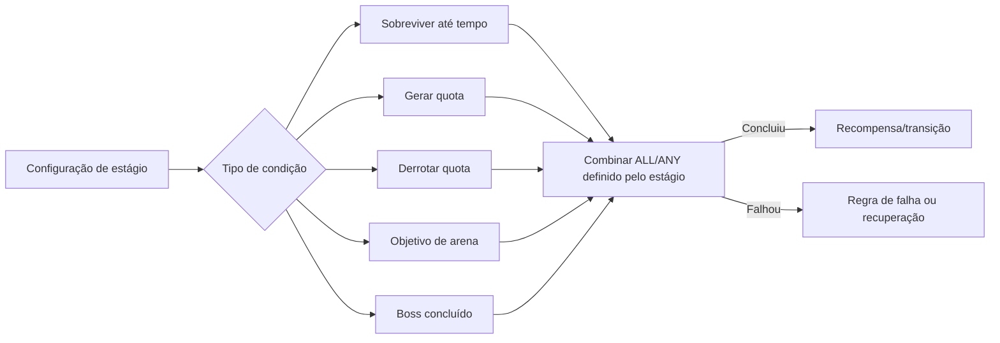
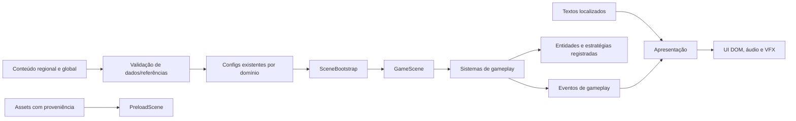

# Jaguar Survivors — Documento de Design do Jogo v0.3

**Tasks de origem:** TASK-005; consolidação aprovada em TASK-006 / TASK-006.1 / TASK-007  
**Status:** Especificação documental consolidada; aprovação não autoriza implementação  
**Idioma deste documento:** Português do Brasil  
**Autoridade:** Product Owner  
**Data:** 2026-11-09

> Este GDD descreve o produto comercial pretendido e separa decisões aprovadas, propostas e TBD. Não autoriza implementação. A Constituição e o Registro de Decisões prevalecem em caso de conflito.

## Convenções de decisão

- **APPROVED:** explicitamente aprovado pelo Product Owner ou já estabelecido na Constituição.
- **PROPOSED:** recomendação deste GDD; requer aprovação antes de virar requisito.
- **EXPERIMENTAL:** conceito autorizado para avaliação/prototipagem, sem compromisso permanente.
- **TBD:** questão em aberto. Não presumir uma resposta.

As seções abaixo usam esses rótulos. Somente decisões identificadas como **APPROVED** no Registro de Decisões são requisitos aprovados. Conceitos ilustrativos não se tornam requisitos por aparecerem neste documento. Aprovações criativas não liberam direitos de uso de pessoas ou assets.

## 1. Visão do produto

| Campo | Definição | Status |
|---|---|---|
| Título | Jaguar Survivors | **APPROVED** |
| Gênero | Ação survivor-like / bullet heaven com construção de builds | **APPROVED** |
| Plataforma inicial | Navegador desktop | **APPROVED** |
| Entradas | Teclado, mouse e gamepad | **APPROVED** |
| Identidade | Jogo comercial independente de sátira política global, ácido e irreverente | **APPROVED** |
| Personagens jogáveis | Cidadãos comuns representados por profissões e arquétipos sociais | **APPROVED** |
| Antagonistas | Figuras políticas públicas reais predominantemente como bosses e antagonistas satíricos; também entidades fictícias institucionais | **APPROVED** como direção; representações específicas exigem revisão |
| Fantasia | Cidadãos comuns sobrevivem aos absurdos de sistemas políticos; sátira altera mecânicas, objetivos, inimigos, regras e decisões | **APPROVED** |
| Campanha comercial inicial | Campanha americana completa, com final regional e gancho global | **APPROVED**; não comprova demanda |
| Monetização | Não decidida | **TBD** |

**Premissa:** cidadãos comuns enfrentam problemas cotidianos e manifestações do poder político. Cada campanha regional é compreensível isoladamente e contribui tematicamente para a narrativa global “O Sistema Nunca Morre”.

**Público e desempenho comercial:** hipóteses de mercado não validadas; nenhum resultado de venda ou demanda é inferido da escolha dos Estados Unidos como primeira campanha.

**Diferenciação — hipótese a validar:** sátira política integrada ao objetivo, às regras dos estágios e às mecânicas de personagens; a política deve alterar decisões de jogo, em vez de aparecer somente como texto decorativo. Não há pesquisa de mercado neste GDD que comprove diferenciação comercial.

**Público inicial — hipótese:** jogadores de survivor-like/roguelite interessados em builds e partidas curtas. Jogadores de sátira política, humor ácido e criadores de conteúdo são segmentos secundários a testar. Não se presume tamanho de mercado, alcance internacional nem conversão.

### Pilares de design (todos PROPOSED)

| Pilar | Significado no jogo | Efeito no conteúdo | Viola o pilar quando… |
|---|---|---|---|
| Combate legível em meio ao caos | Movimento, ameaça, alvo e feedback continuam compreensíveis com muitos inimigos. | Inimigos têm funções e sinais visuais/sonoros distintos. | Efeitos e piadas escondem perigos ou tornam o dano imprevisível. |
| Sátira que altera a partida | Eventos, arenas e poderes transformam incentivos políticos em escolhas e consequências. | Conteúdo usa mecânicas e contexto, não apenas nomes engraçados. | A referência política é só decoração ou exige conhecimento especializado para entender o objetivo. |
| Profissões com identidade jogável | Profissões preservam identidade mecânica entre regiões. | Apresentação pode variar regionalmente sem alterar a identidade mecânica. | Variação local presume homogeneidade étnica ou muda atributos sem decisão. |
| Builds com escolhas reais | Recompensas mudam como o jogador lida com grupos, risco e objetivos. | Armas, itens e habilidades oferecem sinergias legíveis. | A escolha recomendada é sempre óbvia ou não muda a partida. |
| Conteúdo global e expansível | Regiões e contextos variam sem reconstruir os sistemas centrais. | IDs estáveis, texto localizado e comportamentos registrados. | Um pacote regional exige lógica central codificada para cada novo conteúdo. |

Os pilares desenvolvem a direção aprovada; detalhes que não constam como decisão aprovada permanecem propostas ou TBD.

## 2. Estado atual e inventário do jogo

Classificação estática a partir do código e das configurações. “Implementado” significa que há lógica correspondente; não certifica funcionamento, balanceamento ou qualidade em runtime. Nenhum playtest foi feito neste task.

| Sistema/conteúdo | Evidência atual | Status observado | Relevância e recomendação |
|---|---|---|---|
| Inicialização e ciclo de cena | `src/main.js`, `src/scenes/preloadScene.js`, `src/scenes/bootScene.js`, `src/scenes/gameScene.js` | Implementado; execução não verificada aqui | **RETAIN / IMPROVE**: preservar Phaser 3; separar conteúdo comercial dos resíduos legados e validar ciclo. |
| Composição de uma partida | `src/scenes/sceneBootstrap.js` cria managers e sistemas; `GameScene` atualiza e encerra sistemas | Implementado, com responsabilidades/lifecycle a melhorar conforme TASK-001/002 | **RETAIN / IMPROVE** incrementalmente; sem reescrita. |
| Movimento do jogador | `src/entities/player/player.js`, `playerMovement.js`, `playerDash.js` | Setas/WASD e dash por duplo toque direcional no código; runtime não verificado | **RETAIN / IMPROVE**; gamepad ainda é requisito não implementado identificado na inspeção. |
| Ataques e seleção de alvo | `src/entities/weapon/weapon.js`, `src/entities/weapon/strategies/`, `src/systems/combatSystem.js` | Estratégias e colisões implementadas; teste de combate não executado | **RETAIN / INVESTIGATE** clareza, controle, balanceamento e compatibilidade com gamepad. |
| Armas | `src/config/weapons.config.js`, estratégias melee/ranged/trail/orbital | Configuradas e separadas por estratégia | **RETAIN / IMPROVE**; validar conteúdo, legibilidade e equilíbrio. |
| Inimigos e IA | `src/config/enemies.config.js`, `src/systems/ai/`, `src/entities/enemy/` | Muitas configurações e behaviors existem; execução e cobertura não validadas | **RETAIN / IMPROVE**; retematizar/revisar conteúdo antes de uso comercial. |
| Chefes | `bossesConfig`, `bossPhases.config.js`, `BossFlowController` | Dados e fluxo presentes; encontros não testados | **RETAIN / INVESTIGATE**; telegraphs e fases precisam de playtest. |
| XP e upgrades de run | `src/systems/xpSystem.js`, `src/managers/upgradeManager.js` | Lógica de gemas/nível/opções existe; balanceamento não verificado | **RETAIN / IMPROVE**; documentar contratos e testar seleção. |
| Itens, lendários, pickups, estruturas | Configs e managers correspondentes em `src/config/`, `src/managers/`, `src/entities/` | Configurados e parcialmente implementados por múltiplos sistemas; uso em todas as condições não confirmado | **INVESTIGATE / IMPROVE** antes de comprometer escopo. |
| Ondas, relógio, eventos, sudden death | `src/systems/enemySpawner.js`, `src/systems/stageSystem.js` | Progressão atual por timer e eventos temporizados; não runtime-validada | **REWORK** do modelo de configuração para progressão mista por estágio; preservar lógica útil. |
| Endless | `EnemySpawner.startEndlessMode`, UI e eventos | Fluxo existe; loop/balanceamento não testados | **INVESTIGATE**; não é requisito confirmado do primeiro slice. |
| Personagens | Cinco entradas em `src/config/players.config.js` e arte com body/legs | Configurados; identidade e desbloqueios não validados. `main.js` aparenta marcar todos como desbloqueados, enquanto save default lista um | **REWORK** criativo e **INVESTIGATE** integração de unlock; sem aprovar elenco. |
| Mapas | `src/config/maps.config.js`: Favela, Congresso, Avenida/Manifestações e Universidade Pública | Quatro configurações; Favela habilitada, outras três explicitamente desabilitadas | **INVESTIGATE / REWORK** conforme relevância. Não declarar todos jogáveis. |
| Seleção, menu, HUD, pausa e resultados | `index.html`, `src/main.js`, `src/ui/`, `src/managers/hudManager.js` | DOM UI em português; mouse/click e hover; navegação por teclado/gamepad não verificada | **RETAIN / IMPROVE** para identidade global, acessibilidade e gamepad. |
| Narrativa, diálogo e cutscenes | Nomes de ondas, descrições, eventos temporizados e textos de UI; sem sistema dedicado encontrado | Eventos/textos existem; sistema de diálogo/cutscene não implementado ou não localizado | **INVESTIGATE**; começar com eventos curtos, sem framework cinematográfico. |
| Áudio e VFX | `src/managers/audio/`, `src/managers/vfx/`, configs e assets públicos | Sistemas e conteúdo de áudio/imagem presentes; provenance, carregamento completo e experiência não verificados | **RETAIN / IMPROVE** após revisão de licença, tema e lifecycle. |
| Persistência | `src/managers/saveManager.js` via `localStorage` | Moedas, kills, unlocks, upgrades, settings e achievements no modelo atual; versão formal e leitura resiliente insuficientes | **RETAIN / IMPROVE** conforme direção local aprovada. Cloud não aprovado. |
| Controles | `player.js`, `playerMovement.js`, HTML/DOM | Teclado implementado; mouse em menu; nenhuma API de gamepad encontrada na inspeção | Gamepad é requisito **APPROVED** para o produto e VS-001; não estava implementado na inspeção estática. |

### Conteúdo atual e decisão de reaproveitamento

| Conteúdo | Classificação criativa/tecnológica | Recomendação |
|---|---|---|
| Personagens `presida`, `ucraniaman`, `samurai`, `miss`, `mind-changer` | Configuração com identidade e nomes associados ao produto antigo/local; não constitui elenco comercial aprovado | **REWORK / INVESTIGATE**; não presumir reutilização de personagem/arte. Elenco comercial permanece TBD. |
| Favela | Único mapa habilitado; configuração de 5 ondas de 120 s e duração de 600 s; premissa brasileira/local | **INVESTIGATE / REWORK**; mapa candidato, não aprovado para slice ou produto. |
| Congresso, Avenida, Universidade Pública | Configurados, `enabled:false`; conteúdo brasileiro/local; alguns wave durations ausentes, enquanto spawner usa default 60 s | **INVESTIGATE / REWORK**; validação de referências, ritmo e premissa antes de habilitar. |
| `enemy_partido_amarelo`, `item_bandeira_missao`, `Cinto da Missão` e outros conteúdos partidários | Historicamente vinculados ao produto anterior | **REMOVE FROM COMMERCIAL PRODUCT** conforme PD-004; manter arquivos históricos. |
| Composição, estratégias de armas, behaviors, XP e sistemas de combate | Mecanismos tecnicamente reutilizáveis, mas precisam validação e equilíbrio | **RETAIN / IMPROVE**, sem assumir que nomes, balanceamento ou assets atuais são adequados. |
| Assets de figuras/pessoas, logos, áudio e fontes | Licença/proveniência não estabelecida por inspeção estática | **INVESTIGATE**; nenhuma autorização comercial presumida. |

O preload atual percorre conteúdo de configuração, inclusive mapas desabilitados. Isso não prova que cada item aparece no jogo, mas reforça a necessidade de revisar o catálogo comercial e suas referências antes de produção. Não excluí nem removi conteúdo neste task.

## 3. Loop principal

### A. Core combat loop — APPROVED

Movimentar → evitar ataques → atacar automaticamente → coletar XP → escolher upgrades → adaptar build → continuar enfrentando ameaças.

### B. Run loop — APPROVED

Iniciar estágio → sobreviver à escalada → desenvolver build → enfrentar evento político → enfrentar boss → vitória/derrota → ver resultado → poder tentar novamente. VS-001 dura como alvo 15–20 minutos; não há derrota automática por timeout.

### C. Campaign loop — APPROVED como estrutura

Escolher profissão → escolher campanha/estágio disponível → jogar → registrar resultado → avançar narrativa quando aplicável → desbloquear próximo estágio → concluir arco regional. Persistência/desbloqueio detalhados continuam em aberto.

## 4. Combate

### Modelo atual

O jogador usa movimento por teclado e dash. `Weapon.update()` procura alvos ativos e as estratégias executam ataques; `CombatSystem` registra colisões/overlaps. A base é de sobrevivência com gerenciamento de multidão e ataques automáticos/por cooldown. O funcionamento, a prioridade de alvo e o feedback em partida precisam de validação runtime; este documento não certifica sua qualidade.

### Requisitos aprovados para VS-001

- Ataques básicos automáticos; movimento controlado pelo jogador; dash manual; sem mira manual obrigatória.
- Teclado, mouse e gamepad são entradas iniciais do produto. Windows, Chrome, Edge e controle XInput são a referência mínima aprovada para o slice.
- Os detalhes de velocidade, dano, cooldown, alcance, bindings e valores continuam TBD.
- Distinguir contato, projétil, área e status por telegraph e feedback visual/sonoro consistentes.
- Garantir invulnerabilidade, dano, cura e dash feedback legíveis; evitar feedback político que esconda sinais de combate.
- Balancear densidade, velocidade, durabilidade e padrões para criar janelas de decisão e rotas de fuga, não apenas inflação de HP.
- Não fixar valores numéricos sem playtest. Os valores atuais são dados do protótipo, não alvos aprovados.

Categorias de dano/status já aparecem em configurações como burn, freeze, poison e stun. A disponibilidade e o comportamento final de cada efeito devem ser verificados antes de incluí-los no conteúdo comercial.

## 5. Sistema de personagens

Personagens jogáveis são cidadãos comuns apresentados por profissões e arquétipos sociais. Figuras políticas públicas reais são predominantemente bosses e antagonistas satíricos; figuras fictícias podem representar problemas institucionais. Profissões podem reaparecer em regiões diferentes com apresentação visual/narrativa local, preservando gameplay e atributos (**APPROVED**, PD-003; D-006-08, D-006-28). O protagonista de VS-001 é um trabalhador de escritório. Quantidade de personagens para o produto comercial permanece TBD. Revisão editorial/jurídica específica é necessária para representações reconhecíveis.

### Ficha padrão — PROPOSED

| Campo | Finalidade |
|---|---|
| ID estável | Referência interna independente de idioma/nome público |
| Nome exibido/localização | Nome, codinome ou forma final, conforme decisão e revisão |
| País, região, período e ambiente político | Contexto cultural, não premissa de aprovação |
| Referência real e estado de revisão | Fonte, delimitação da representação e validações pendentes |
| Interpretação satírica | Contradição/comportamento alvo e intenção de humor |
| Visual, personalidade e hooks narrativos | Identidade audiovisual e textos localizados |
| Papel e modificadores de atributos | Diferença mecânica mensurável |
| Arma inicial, passiva e habilidade ativa opcional | Ponto de partida de build |
| Forças, custos e arquétipo de build | Contrapartidas que criam escolhas |
| Desbloqueio | Regra local/progressão ainda TBD |
| Animação, áudio e acessibilidade | Silhueta, leitura, feedback e apresentação |

O modelo de ficha acima é uma proposta documental, não uma autorização de novos personagens. Variações regionais não devem presumir uma etnia ou aparência homogênea por país.

## 6. Armas, upgrades e builds

O código atual possui estratégias melee, ranged, trail e orbital e uma configuração ampla de weapons, items, pickups, legendaries e achievements. `gameplay.config.js` declara limites de 2 armas, 3 itens e 5 lendários; `WeaponManager` aplica limite de duas armas. Não verifiquei a aplicação de todos os limites em runtime. `CONFIG.synergies` é inicializada vazia e comentários do `UpgradeManager` mencionam limite de seis, divergindo da regra atual de slots.

### Requisitos aprovados para VS-001

- Preservar categorias/estratégias existentes se os testes mostrarem clareza e manutenção razoável.
- Usar upgrades para modificar padrões, área, risco, controle e sinergia; evitar somente bônus lineares repetidos.
- Três armas disponíveis, no máximo duas equipadas ao mesmo tempo; Maleta Executiva é a arma inicial.
- Ao subir de nível, escolher uma melhoria entre três opções.
- Armas secundárias, nomes das outras armas, valores, evolução, raridade e sinergias permanecem TBD. Não inferir aprovação a partir do inventário técnico atual.
- Fazer cada opção explicar em linguagem simples o efeito mecânico e, se pertinente, o alvo satírico.
- Temas como propaganda, lobby, escândalo, burocracia, opinião pública e influência são apenas **direções conceituais**, não mecânicas aprovadas.

Arquétipos de build podem ser testados como nomes de balanceamento: área/controle, precisão/alvo prioritário, mobilidade/evasão e efeitos ao longo do tempo. Não formam classes fechadas nem roster aprovado.

## 7. Inimigos e chefes

As configurações atuais têm uma lista numerosa de inimigos e bosses, parâmetros de comportamento, AI behaviors e boss phases. Os nomes e configurações atuais não constituem roster final, e sua execução não foi verificada em runtime.

### Arquétipos comuns de VS-001 — APPROVED

| Função | Desafio criado |
|---|---|
| Básico/enxame | Pressão por volume e necessidade de rota. |
| Perseguidor rápido | Obriga movimento e priorização. |
| Pesado | Bloqueia rota e exige dano/tempo. |
| Enxame | Pressão por volume. |
| Rápido | Obriga movimento e priorização. |
| Pesado | Pressiona rotas e exige resposta de build. |

### Ficha de inimigo — PROPOSED

ID, nome/localização, conceito satírico, função, comportamento registrado, movimento, ataques, durabilidade/dano (valores TBD), habilidades, regra de spawn, compatibilidade de mapa e requisitos de visual/áudio.

Donald Trump é o boss aprovado de VS-001 (D-006-32), com duas fases e dois ataques básicos. Por D-007-03, os ataques são uma investida em linha reta com telegraph e impactos em áreas marcadas que explodem após atraso. Abaixo de 50% de HP, a segunda fase combina os dois ataques em sequências mais rápidas, mantendo telegraphs legíveis. O protótipo deve usar visual e texto placeholder não identificáveis até revisão editorial/jurídica separada. Falas, visual final e assets identificáveis continuam TBD e não estão liberados para uso comercial. Bosses fictícios sugeridos para os estágios 1 e 3 continuam propostas.

## 8. Mapas e mundos

`maps.config.js` contém quatro configurações observadas na auditoria da seção 2; configurações históricas não são automaticamente conteúdo comercial. VS-001 se passa em ambiente fantástico caricatural inspirado no Congresso/Capitólio dos Estados Unidos. A primeira versão comercial tem campanha americana completa; outras regiões ficam para evolução posterior (D-006-30, D-006-31, D-006-34). O título da campanha e nomes finais dos estágios permanecem provisórios/TBD.

### Base do graybox — APPROVED por D-007-05

O graybox de VS-001 pode usar o mundo existente de 1500 × 1500. Isso define a base dimensional para prototipagem, não o layout final: hazards, estruturas, distribuição de obstáculos e identidade visual detalhada permanecem TBD. Assets legados não são automaticamente aprovados para reutilização.

### Especificação de mapa — PROPOSED

ID; nome/localização; país/região/período; ambiente político; descrição e estado editorial/legal; identidade visual; hazards; estruturas; pool de inimigos e chefes; sequência de estágios; eventos; condição e duração (TBD); regras de progressão; recompensa; áudio; referências/proveniência de assets.

Mapas devem diferir por pressão e decisões de jogo, não somente por fundo. O ambiente do VS-001 e a primeira região (Estados Unidos) estão aprovados; países e ordem posteriores permanecem **TBD**. Conteúdo antigo pode ser retirado da versão comercial sem ser apagado do histórico.

## 9. Progressão mista por estágio

Para VS-001, progressão temporizada conduz a escalada e entrada do boss; derrotar o boss dá vitória, HP do jogador em zero dá derrota e não existe timeout automático de derrota (**APPROVED**, D-006-02, -16, -19). Duração-alvo: 15–20 minutos. Os marcos iniciais abaixo foram aprovados por D-007-01; tuning pode ocorrer durante validação sem alterar as condições de vitória/derrota.

| Tempo decorrido | Progressão aprovada |
|---|---|
| 0–3 min | Primeiro bloco de escalada. |
| 3–6 min | Segundo bloco; aumentar pressão em relação ao bloco anterior. |
| 6–9 min | Terceiro bloco; Cabinet Crisis começa em 8:00. |
| 8:00–9:00 | Cabinet Crisis aumenta frequência de spawn em 25%, com feedback visual/textual claro de início e fim (D-007-02). |
| 9–12 min | Quarto bloco de escalada. |
| 12:00 | Boss entra. Não há timeout; a partida termina quando o boss é derrotado ou o HP do jogador chega a zero. |

O escalonamento é determinístico, sem ajuste adaptativo de dificuldade (D-007-06). A luta deve permitir que o alvo geral de 15–20 minutos seja alcançável sem transformar 20 minutos em limite de derrota.

| Modelo | Objetivo/condição de conclusão | Vantagem | Risco/custo |
|---|---|---|---|
| Sobreviver por duração | Manter-se vivo até o timer | Regra direta e tensão crescente | Pode parecer passivo ou ignorar quota de spawn |
| Quota de spawn | O sistema gera uma quantidade definida | Dá controle sobre composição/densidade | Spawn concluído não significa ameaça vencida |
| Quota de derrotas | Derrotar quantidade mínima | Vincula progresso ao combate | Pode alongar fase se inimigos escaparem ou build for lenta |
| Boss | Derrotar boss com telegraphs/fases | Clímax claro | Precisa de arena, leitura e tuning robustos |
| Objetivo | Completar tarefa no mapa | Varia o loop | Requer UX de estado/progresso e telegraphs claros |
| Híbrido | Combinar condições com regra ALL/ANY explícita | Mais variedade e controle narrativo | Mais casos de borda e necessidade de validação de conteúdo |

### Distinções de estado

- **Gatilhos de progressão** modificam o andamento do estágio: tempo decorrido, inimigos eliminados, objetivos intermediários concluídos, eventos políticos/narrativos ou ativação de ondas/bosses. Um gatilho, por si só, não significa vitória.
- **Condição de conclusão de VS-001:** derrotar o boss.
- **Condição de falha de VS-001:** HP do jogador chega a zero. Duração-alvo não é limite de derrota.

Máquina de estados conceitual, sem prescrever arquitetura ou implementação:

`PREPARATION → IN_PROGRESS → VICTORY | DEFEAT`

`PREPARATION` prepara/inicializa; `IN_PROGRESS` é o estágio ativo; `VICTORY` é conclusão bem-sucedida; `DEFEAT` é uma falha explícita. Este modelo é conceitual. VS-001 não tem derrota automática por timeout; limites de duração em outros estágios permanecem TBD. Se várias condições puderem ocorrer simultaneamente, a precedência deve ser definida para o estágio aplicável.

**Framework proposto:** cada estágio declara um conjunto pequeno de condições registradas, o operador ALL/ANY, limites/timeout e regra de falha/recompensa. Resolver objetivo não deve avançar silenciosamente se quota/boss ainda forem necessários. Condições de recuperação para softlock e cancelamento de evento devem ser explícitas.



Condições mistas adicionais e regras para outros estágios permanecem TBD; não presumir timeout ou objetivos extras.

## 10. Sátira política e narrativa

O tom ácido, provocativo, irreverente e independente de partido é **APPROVED**. A sátira mira poder político, instituições, comportamentos, contradições e incentivos em diferentes espectros. Cidadãos comuns enfrentam absurdos de sistemas políticos; figuras públicas reais aparecem predominantemente como bosses/antagonistas satíricos. Cada representação identificável requer revisão editorial/jurídica; aprovação criativa não é liberação de uso.

### Narrativa global — O Sistema Nunca Morre (APPROVED)

1. **Sobreviver:** cidadãos enfrentam dificuldades políticas e sociais de suas regiões.
2. **Reconhecer padrões:** campanhas independentes revelam contradições e problemas semelhantes em estruturas diferentes.
3. **Confrontar:** campanha final fictícia contra a representação da máquina global do poder; após vencê-la, o jogador escolhe aceitar ou rejeitar a oportunidade de assumir o comando. O final tematiza a perpetuação do poder e não implica sistema de governo, estratégia ou conquista territorial.

Não apresentar a máquina como conspiração real ou entidade factual responsável por governos existentes. A conclusão global é direção narrativa aprovada para evolução posterior, fora do VS-001 e não automaticamente parte da primeira versão comercial.

### Campanha americana — APPROVED como estrutura

Primeira versão comercial: campanha dos Estados Unidos com três estágios, final regional próprio e gancho para a narrativa global. Título provisório “The American Dream Is Not Responding”, ainda não aprovado como título comercial.

1. **Cotidiano — “The Daily Grind” (nome provisório):** cidadão enfrenta problemas econômicos e burocráticos e formaliza uma reclamação, encaminhada a uma audiência política extraordinária. “The Debt Collector” é proposta de boss fictício, não aprovado.
2. **Espetáculo político — “The Political Machine” (nome provisório):** a reclamação vira acontecimento público em arena fantástica inspirada no Congresso/Capitólio americano. Donald Trump é o boss aprovado; sua derrota revela que o processo continua em outra camada administrativa.
3. **Máquina administrativa — “The Permanent Government” (nome provisório):** centro fictício do processamento da reclamação, com obstáculos institucionais. “The Administrator” é proposta, não aprovado. Após vitória, reclamação local é resolvida; encerramento sugere mecanismos semelhantes em outras regiões.

A reclamação do cidadão conecta os três estágios e reaparece como motivo no universo global (D-006-35). A estrutura não aprova automaticamente detalhes ilustrativos, mapas adicionais ou bosses dos estágios 1 e 3.

O código atual possui eventos temporizados de estágio e `GameEventHandler`, mas não foi encontrado sistema de diálogo/cutscene. **PROPOSED:** começar com eventos curtos via dados e UI: gatilho → efeito de gameplay → texto localizado/feedback → resultado. Isso aproveita os sistemas existentes e evita framework cinematográfico prematuro.

Exemplos conceituais, não aprovados: escândalo muda composição/comportamento dos inimigos; crise altera uma zona segura; eleição troca condição de objetivo; opinião pública modifica temporariamente risco/recompensa. Efeito, texto e pessoa/partido associados ficam TBD até aprovação.

## 11. Metaprogresso e replayabilidade

`SaveManager` e `AchievementManager` suportam dados de coins, kills, unlocks, upgrades permanentes, settings e achievements no estado de código observado; isso não significa que todo esse progresso esteja aprovado para VS-001. A integração de desbloqueios de personagens aparenta inconsistência e requer teste. Run history e leaderboard não foram encontrados.

| Sistema entre runs | Benefício | Risco/custo | Status |
|---|---|---|---|
| Unlocks de personagem/mapa/arma | Objetivos e exposição a conteúdo | Gate pode impedir testar personagem; demanda balanceamento e save | **PROPOSED**, desenho específico TBD |
| Upgrade permanente | Sensação de progresso | Pode tornar runs antigas triviais ou exigir grind | **PROPOSED**, magnitude TBD |
| Achievements/challenges | Metas paralelas e replay | Pode virar checklist sem valor de jogo | **PROPOSED** |
| Estatísticas/resumo de run | Comparar estratégias | Requer definição de retenção e privacidade | **PROPOSED** |
| Ranking/online | Competição | Backend/moderação/manutenção, não aprovado | **TBD; fora do slice recomendado** |

Separar metaprogresso narrativo (registro/desbloqueio de campanhas e estágios) de poder permanente. VS-001 não exige metaprogresso de poder nem economia de moedas. O produto pode usar desbloqueios narrativos sem impor grind ou aumento permanente de poder. Modelo, recompensas e save narrativo detalhado permanecem TBD.

## 12. UX e controles

Desktop browser e teclado, mouse e gamepad são **APPROVED**. Para VS-001, referência mínima aprovada: Windows, Chrome, Edge e controle XInput (D-006-23). Isso não declara compatibilidade runtime implementada ou testada. O código atual implementa setas/WASD, dash por duplo toque e Escape para pausa; mouse é usado em menus/cards. A inspeção v0.1 não encontrou Phaser Gamepad API. Cards gerados por `div` e foco/acessibilidade precisam de validação.

### Requisitos propostos para UX

- Menus, opções, upgrade e pausa inteiramente navegáveis por gamepad e teclado, com foco visível, confirmar/voltar e reconexão após desconexão.
- Mouse pode selecionar/navegar nos menus. O combate atual não usa mira de mouse; não introduzir mira sem decisão de design.
- Ações a mapear: movimento, dash, pausa, confirmar/voltar, habilidade ativa se aprovada. Bindings finais TBD.
- HUD comunica saúde/escudo, XP, condição atual do estágio, perigos, escolhas disponíveis e estados de controle.
- Preferências de áudio, texto, acessibilidade e tela devem ser localizáveis. Contraste/forma/efeito não podem ser o único indicador de perigo.
- Testar foco, escala de texto, movimento/efeitos intensos, cor, legibilidade e onboarding. Sem afirmar conformidade formal ainda.
- Layout 1280×720 tem escala para viewport, mas qualidade em ultrawide/tela pequena não foi validada. Matriz de desktop TBD.

## 13. Persistência e dados salvos

Persistência local inicial é **APPROVED**; cloud saves não foram aprovados. O save atual é `localStorage` (`jaguar_survivors_save_v1`) e guarda coins, totalKills, unlockedChars, metaUpgrades, settings e achievements. Não vi um campo de versão formal. `load()` acessa localStorage antes do try/catch de parse, então armazenamento indisponível pode impedir inicialização (risco de código observado, não teste reproduzido).

**Desenho proposto, sem implementação:**

- Envelope do save com `schemaVersion`, timestamps opcionais e grupos de dados estáveis.
- Migrações explícitas entre versões; defaults para campos novos; rejeição/backup controlado de dados malformados.
- Tratamento de leitura/escrita indisponível sem impedir o jogo; definir feedback de falha e opção de recuperação.
- Salvar somente estado persistente aprovado. Estatísticas detalhadas e export/import permanecem TBD.
- Sem conta, servidor ou sync na primeira etapa. Reavaliar cloud apenas se necessidade de cross-device/conta for aprovada.

## 14. Direção visual e áudio

Arte de VS-001 é provisória, coerente e legível, com identidade satírica reconhecível (**APPROVED**). Identidade visual final é **TBD**. A aprovação de Donald Trump como boss não aprova aparência final, voz, frases, fotografias, marcas ou outros assets identificáveis. Revisão editorial/jurídica apropriada e proveniência/licenças continuam necessárias antes de uso comercial.

**Princípios propostos:** silhueta e pose reconhecíveis sem depender de texto; inimigos/projéteis/telegraphs distinguíveis sob densidade; caricatura exagerada sem uso automático de fotografia; identidade de mapa através de paleta, composição, hazard e paisagem sonora; UI com hierarquia de objetivo, perigo e recompensa.

Áudio deve diferenciar dano, acerto, seleção, boss e estado de perigo sem saturar a mixagem. Música, locução/voz e imitação de voz de figura real são decisões abertas; voz sintética/imitação não está aprovada. Assets atuais são candidatos a revisão, não recursos liberados. Proveniência, licença e consistência visual/sonora precisam de auditoria antes do uso comercial.

## 15. Internacionalização e acessibilidade

Inglês e português brasileiro são os idiomas aprovados para VS-001 (D-006-33). A interface observada na auditoria é majoritariamente texto português hardcoded e `index.html` declara `pt-BR`; isso não demonstra arquitetura de localização nem que os idiomas estejam implementados.

**Direção documental:** separar texto traduzível de lógica/configuração, usar IDs estáveis e organizar strings por locale; considerar expansão de texto, pluralização e revisão cultural. A implementação permanece não verificada e não autorizada por este GDD.

Onboarding deve explicar movimento, dash, build e objetivo com linguagem simples. Combate requer feedback por forma/animação/áudio além de cor. Menus precisam de semântica/foco DOM; acessibilidade, suporte assistivo, opções de movimento e limites de efeitos permanecem área de validação.

## 16. Produto comercial e monetização

O escopo inicial comercial é a campanha americana completa, com três estágios e gancho global; a escolha não comprova demanda. Nenhum modelo, preço, loja ou distribuição foi aprovado. Não introduzir economia, anúncios ou pagamento em mecânicas como requisito.

| Modelo | Vantagens potenciais | Custos/riscos | Status |
|---|---|---|---|
| Demo grátis em navegador | Fricção baixa para testar identidade e primeira partida | Descoberta, compatibilidade e manutenção de browser ainda precisam ser avaliadas | **PROPOSED experimento** |
| Demo/versão inicial no itch.io | Distribuição direta e feedback da comunidade | Alcance e disposição de pagar não conhecidos | **PROPOSED experimento** |
| Premium desktop em loja | Compra simples se conteúdo e polimento sustentarem o valor | Exige conteúdo, QA, suporte, disclosure e publicação | **PROPOSED hipótese posterior** |
| Demo grátis + versão completa paga | Mantém entrada simples e pode dar motivo para compra | Duas builds e valor pago precisam ser claros | **PROPOSED hipótese posterior** |
| F2P, anúncios, DLC/expansões | Pode financiar evolução em cenários apropriados | Economia, operação, UX e risco de diluir tom; escopo atual não justifica decisão | **TBD** |

**Sequência de validação recomendada — PROPOSED:** testar protótipo/slice no browser; medir compreensão da proposta, conclusão/replay e friction de controle; avaliar disposição de pagar somente depois de demonstrar repetição e valor de conteúdo. Não existem projeções de receita neste GDD.

Para eventual Steam, revisar onboarding/regras de conteúdo e Content Survey; a plataforma lista restrições sobre conteúdo difamatório e conteúdo sem direitos adequados e exige consistência nas divulgações. Suas políticas não equivalem a liberação jurídica. [Steam onboarding](https://partner.steamgames.com/doc/gettingstarted/onboarding), [Steam Content Survey](https://partner.steamgames.com/doc/gettingstarted/contentsurvey?l=english). Acesso em 2026-11-08.

## 17. Arquitetura de conteúdo

**Objetivo — alinhado a PD-011, PD-009 e D-006-27/-28:** organizar conteúdo por campanha/região, profissão, estágio e locale, separando sistemas estáveis de jogo do conteúdo expansível sem reescrever o projeto Phaser 3. Trata-se de orientação documental; não aprova mudança arquitetural ou implementação.



### Modelo conceitual — ILUSTRATIVO, não código nem configuração aprovada

```json
{
  "id": "profession.example",
  "campaignId": "campaign.region.example",
  "stageId": "stage.example",
  "locale": "en-US",
  "identity": { "nameKey": "profession.example.name", "region": "TBD", "period": "TBD" },
  "review": { "representation": "TBD", "assetRights": "TBD" },
  "gameplay": { "role": "TBD", "startingWeaponId": "TBD", "passiveBehaviorId": "TBD" },
  "presentation": { "portraitAssetId": "TBD", "descriptionKey": "character.example.description" }
}
```

**Princípios propostos:** IDs estáveis não traduzidos; strings fora da lógica de gameplay; behaviors em registro de código conhecido; configurações referenciam conteúdos e assets por ID; validação detecta IDs ausentes, campos obrigatórios e incompatibilidade de progressão; metadata registra fonte/licença/revisão de assets. Não criar framework genérico ou linguagem de script sem necessidade demonstrada.

## 18. Vertical Slice — VS-001 The Political Machine

**Status:** escopo aprovado documentalmente (TASK-006). Aprovação não é autorização para implementação, publicação de representação ou produção de assets.

| Campo | Escopo aprovado |
|---|---|
| Região / ambiente | Estados Unidos; arena fantástica caricatural inspirada no Congresso/Capitólio |
| Protagonista | Trabalhador de escritório, apresentação regional americana |
| Boss | Donald Trump, satiricamente representado, sujeito a revisão editorial/jurídica |
| Idiomas | Inglês e português brasileiro |
| Duração / marcos | Alvo 15–20 minutos; blocos de escalada a cada 3 minutos; Crise aos 8:00 por 60 s; boss aos 12:00; sem timeout automático de derrota |
| Combate | Ataques básicos automáticos, movimento controlado, dash manual, sem mira manual obrigatória |
| Build | Maleta Executiva (projétil retornável), Carimbo de Aprovação (impacto automático em área), Papelada (rajada automática de projéteis); até duas equipadas; upgrade de uma entre três opções ao subir de nível |
| Encontros | Três arquétipos comuns (enxame, rápido, pesado); Crise de Gabinete aumenta spawn em 25% por 60 s; boss em duas fases, com investida telegráfica e impactos atrasados em áreas marcadas |
| Progressão / resultado | Quatro blocos de 3 min; Crise aos 8:00; boss aos 12:00; vitória ao derrotar o boss; derrota a HP zero; sem derrota por timeout |
| Plataformas de referência | Windows; Chrome e Edge; XInput como referência de controle |
| Persistência | Configurações e resultados locais; sem metaprogresso de poder obrigatório; sem cloud save |

Persistência de progresso narrativo será necessária quando houver múltiplos estágios/campanhas, mas seu modelo detalhado continua TBD. Introdução breve contextualiza a reclamação e a chegada à arena sem exigir o Ato I. Após vencer, conclusão curta revela que a reclamação segue sem solução e prepara o Ato III. O slice deve funcionar isoladamente.

### Aceitação aprovada

**Gameplay:** run completa até resultado; movimento e dash; ataques automáticos; XP/upgrades; três armas disponíveis e duas simultâneas; três arquétipos; Crise de Gabinete com efeito mecânico; boss de duas fases/dois ataques; vitória e derrota conforme as regras acima.

**Identidade:** profissão jogável clara; ambiente americano reconhecível e fantástico; humor no tom aprovado; evento altera a experiência; introdução e conclusão compreensíveis.

**Qualidade:** compatibilidade com navegadores/controles aprovados; nenhum erro não tratado no fluxo principal; restart sem listeners, timers ou eventos duplicados; assets carregam corretamente. Meta de desempenho: média de 60 FPS e frame-time P95 abaixo de 33,3 ms durante gameplay, com hardware de teste documentado e limite inicial de 50 inimigos ativos simultaneamente (D-007-06/-07). É uma meta mensurável para o slice, não garantia para todo hardware.

**Plano de validação técnica aprovado (D-007-08):** verificar sistemas isolados onde for prático, uma run completa, teclado/mouse/XInput, compatibilidade nos browsers de referência, restart/cleanup de cena e registrar desempenho. Framework de testes, dependências e percentual de cobertura permanecem TBD; nenhum deles está selecionado ou autorizado por esta decisão.

**Validação:** playtest inicial com cinco jogadores-alvo, registrando compreensão do objetivo e sátira, diferenciação mecânica, clareza dos upgrades, controles, dificuldades e intenção de jogar novamente. Meta exploratória: pelo menos quatro de cinco explicam objetivo e elemento satírico central sem ajuda. A amostra não comprova demanda comercial.

### Dependências e limites

Valores de dano, HP, cooldown, spawn e XP permanecem sujeitos a balanceamento; hazards, estruturas e layout detalhado permanecem TBD. Ferramenta/framework de testes e percentual de cobertura também permanecem TBD. Falas, visual final, direitos e assets identificáveis do boss exigem revisão editorial/jurídica; bosses dos estágios 1 e 3, nomes finais de campanha/estágios, economia e recompensas permanecem TBD/propostos conforme o Registro. Outras campanhas, metaprogresso complexo e arco global completo não pertencem ao slice. A identidade aprovada de boss não concede liberação editorial/jurídica ou de publicação.

## 19. Não objetivos e controle de escopo

VS-001 não inclui outras campanhas completas, metaprogresso complexo, arco global completo, narrativa cinematográfica extensa, multiplayer, contas online, cloud save, mobile ou console, live service, UGC, monetização definida, migração de engine/framework ou reaproveitamento total de conteúdo antigo. Mobile e console não são alvos iniciais aprovados; evolução futura requer decisão separada.

Cloud save não está aprovado inicialmente (PD-010). Não iniciar sistema online, monetização, novo framework de conteúdo ou migração técnica por conveniência. Mudanças de escopo e decisões fundamentais passam por governança.

## 20. Riscos e perguntas abertas

Escala qualitativa, não previsão. Nenhuma conclusão jurídica está sendo emitida.

| ID | Risco | Prob. | Impacto | Prioridade | Mitigação proposta | Momento recomendado / dependência |
|---|---|---:|---:|---|---|---|
| R-01 | Direitos de imagem/publicity, marca, copyright ou voz em figura reconhecível | Média | Alto | **HIGH** — pode impedir conteúdo específico e publicação. | Revisão por counsel por jurisdição, proveniência e revisão de loja. | Antes de selecionar/liberar representação; bloqueia conteúdo específico. |
| R-02 | Defamação ou impressão de endosso/alegação factual | Média | Alto | **HIGH** — pode gerar risco jurídico e reputacional na publicação. | Enquadramento claro de sátira, separar opinião e fatos, revisão jurídica/editorial. | Antes da aprovação de conteúdo e publicação. |
| R-03 | Polarização faz o produto ser percebido como propaganda de um lado | Média | Alto | **HIGH** — compromete identidade independente e validação da proposta. | Testar percepção entre jogadores diversos; revisar alvos e perspectiva do conteúdo. | Durante revisão editorial/playtest; bloqueia validação de identidade. |
| R-04 | Referências não são entendidas internacionalmente | Alta | Médio/alto | **HIGH** — compreensão global é central e pode falhar já no slice. | Playtest sem explicação local; separar mecânica universal de contexto regional. | Antes de validar idioma/região; bloqueia validação global. |
| R-05 | Conteúdo antigo estigmatiza grupos ou não serve ao produto global | Média | Alto | **HIGH** — reutilização indevida pode contradizer identidade e gerar dano reputacional. | Revisar premissa de cada inimigo/mapa; priorizar crítica ao poder e comportamento. | Antes de reutilização comercial; bloqueia conteúdo afetado. |
| R-06 | Asset sem proveniência/licença clara | Média | Alto | **HIGH** — pode bloquear build comercial. | Inventário de origem/licença, substituição e aprovação. | Antes de incluir asset em build comercial; bloqueia publicação. |
| R-07 | Escopo e custo de elenco/mapas crescem sem validar repetição | Alta | Alto | **HIGH** — ameaça custo e foco antes de evidência do slice. | Slice pequeno e gates de produção. | Antes de expansão ampla. |
| R-08 | Conteúdo global exige codificar lógica especial repetidamente | Média | Médio | **MEDIUM** — pode elevar manutenção, mas não impede protótipo inicial. | IDs estáveis, behaviors registrados e validação de conteúdo. | Ao definir schemas/conteúdo além do protótipo. |
| R-09 | Progresso de estágio confuso ou preso em condição híbrida | Média | Alto | **HIGH** — pode impedir conclusão ou produzir resultado incorreto no slice. | Separar gatilhos, conclusão e falha; explicitar ALL/ANY, precedência e testar casos de borda. | Antes de implementar regra do slice; bloqueia aceitação. |
| R-10 | Cobertura funcional de gamepad ainda não validada, apesar do requisito aprovado | Alta | Alto | **HIGH** — input aprovado pode não funcionar no slice. | Validar gameplay, menus e conexão/desconexão em controle XInput de referência. | Antes da aceitação do slice; outros modelos permanecem fora da referência aprovada. |
| R-11 | Performance/estabilidade degradam com aumento de inimigos, projéteis, VFX, duração ou repetição de ciclos | Desconhecida | Alto | **HIGH** — pode inviabilizar estabilidade e desempenho sob carga. | Limite inicial de 50 inimigos; medir média e P95 do frame-time e observar ciclos repetidos. | Antes do sign-off de performance; usar e documentar hardware de teste. |
| R-12 | Falha ou corrupção de save bloqueia entrada/perda de progresso | Média | Médio | **MEDIUM** — configurações e resultados locais estão aprovados para o slice; modelo detalhado e persistência narrativa futura permanecem abertos. | Schema versionado, fallback e validação com storage indisponível/corrupto. | Antes de implementar save; detalhes do modelo local TBD. |
| R-13 | Listeners, timers, callbacks ou recursos podem permanecer ativos após shutdown/restart de cenas (risco de lifecycle; não confirmado por teste) | Média | Alto | **HIGH** — comportamento inconsistente/vazamento pode afetar ciclos de jogo. | Inspecionar propriedade e limpeza de recursos; validar restart quando houver harness. | Antes de refatoração significativa e aceitação de restart; conforme TASK-002. |
| R-14 | Ausência de cobertura automatizada conhecida pode permitir regressões durante refatoração/evolução dos sistemas (estado de cobertura não verificado) | Alta | Alto | **HIGH** — mudanças incrementais podem quebrar fluxo central sem detecção. | Aplicar o escopo de validação D-007-08; definir framework e cobertura antes de refatoração significativa. | Antes de refatoração significativa; harness/percentuais permanecem TBD. |
| R-15 | Lojas/políticas ou divulgações mudam/recusam build | Baixa/média | Alto | **MEDIUM** — relevante na submissão, não bloqueia protótipo. | Revalidar políticas na submissão, preencher disclosures com precisão. | Antes da distribuição; plataforma TBD. |
| R-16 | Monetização escolhida antes de demonstrar valor | Média | Alto | **MEDIUM** — pode comprometer escopo e UX sem evidência. | Adiar escolha e testar demo/replay primeiro. | Após evidência do slice; não bloqueia slice. |

No Brasil, a Constituição protege expressão artística e também honra/imagem; o Código Civil contém disposições sobre imagem e uso comercial. Nos EUA, fair use é análise contextual, sem fórmula de quantidade que garanta resultado. Steam publica regras de conteúdo e uma pesquisa pré-release. Esses materiais apontam áreas de revisão, **não determinam a legalidade de qualquer representação deste jogo**. Consultar counsel qualificado nos mercados escolhidos antes de lançamento comercial. [Constituição Federal](https://www4.planalto.gov.br/legislacao/legis-federal/constituicao), [Código Civil](https://www.planalto.gov.br/ccivil_03/leis/2002/l10406compilada.htm), [U.S. Copyright Office — Fair Use](https://www.copyright.gov/help/faq/faq-fairuse.html), [Steam Content Survey](https://partner.steamgames.com/doc/gettingstarted/contentsurvey?l=english). Acesso em 2026-11-08.

### Pendências de produto

- Visual/falas/assets identificáveis do boss Donald Trump e revisão editorial/jurídica antes de conteúdo final/publicação.
- Identidade dos bosses dos estágios 1 e 3; nomes finais de campanha/estágios; hazards e layout detalhado do mapa.
- Dano, HP, cooldown, spawn, XP e demais valores de balanceamento; framework/dependências e percentuais de cobertura de testes.
- Economia/recompensas da campanha; quantidade de personagens jogáveis comerciais; modelo/preço; distribuição final.
- Países posteriores e ordem de lançamento; implementação da campanha global completa.
- Demais decisões ainda TBD no Registro, incluindo dificuldade, matriz completa de browsers/controles e modelo detalhado de persistência narrativa.

Essas pendências não invalidam as decisões documentadas, mas limitam planejamento/produção dos itens dependentes. Nenhuma revisão jurídica é declarada concluída.

## Referências de governança e produto

- [`Project Constitution`](../00-governance/PROJECT-CONSTITUTION.md)
- [`Product Decision Register`](../00-governance/PRODUCT-DECISIONS.md)
- [`Workflow`](../00-governance/WORKFLOW.md)
- TASK-001, TASK-002, TASK-003 e TASK-004 estão no histórico desta conversa, mas seus relatórios não foram encontrados como documentos no repositório durante a inspeção.

## Revisão e aprovação

Este GDD v0.3 consolida as decisões de TASK-006 conforme TASK-006.1 e as decisões aprovadas de TASK-007. A seção 2 preserva a auditoria estática, referências de arquitetura e limitações de validação da v0.1; aprovações de produto não alteram o status observado do código. Conteúdo legado é candidato a revisão/reaproveitamento, não liberado automaticamente; arquivos históricos não devem ser apagados por esta decisão. Este documento não autoriza implementação. O desenvolvimento do VS-001 requer autorização separada, observando os TBDs residuais, riscos e gates de revisão editorial/jurídica.
